<div align="center">

# Coucou 架構總覽

**專案結構 · AI Agent 之間如何被管理 · 如何接入 n8n 這類外部 Agent Endpoint**

</div>

> 本文依據目前 `main` 分支的程式碼整理。第 1–5 節描述**已經存在**的實作；第 6–7 節是**尚未實作**的整合設計提案。
> 檔案路徑皆相對於 repo 根目錄。

---

## 目錄

1. [一頁看懂](#1-一頁看懂)
2. [專案全貌](#2-專案全貌)
3. [Windows 版分層架構](#3-windows-版分層架構)
4. [Agent 接入 Coucou 的三種方式](#4-agent-接入-coucou-的三種方式)
5. [團隊協作:Agent 之間如何被管理](#5-團隊協作agent-之間如何被管理)
6. [現有的擴充接縫](#6-現有的擴充接縫)
7. [整合 n8n 等外部 Agent Endpoint](#7-整合-n8n-等外部-agent-endpoint)
8. [附錄:關鍵檔案索引](#8-附錄關鍵檔案索引)

---

## 1. 一頁看懂

Coucou 是一個常駐在螢幕頂端的小角色 **Mochi**,它做三件事:

| 層次 | 做什麼 | 平台 |
|---|---|---|
| **觀察** | 透過 hook 看見你自己在終端機開的 Claude Code / Copilot CLI / Antigravity,並在島上按「允許 / 拒絕」 | macOS + Windows |
| **駕駛** | Coucou 自己啟動 coding agent(Copilot、Codex、Claude Code、Antigravity),從島上的聊天列對它下指令 | Windows |
| **團隊協作** | 多個 agent 組成一個團隊,由 leader 拆任務、成員交付、互相審核,Coucou 居中調度並記錄一切 | Windows |

多 agent 管理的核心設計只有一句話:

> **Agent 之間從不直接對話。每個成員只跟 Coucou 說話(透過 `coucou-team` MCP 工具),Coucou 保存唯一的一份事件紀錄,並決定誰拿到下一個回合。**

這是一個 **Hub-and-Spoke(軸輻式)+ Event Sourcing(事件溯源)** 的架構。所有畫面(看板、辦公室、中二模式、成本)都只是這份紀錄的投影,從不從 agent 隨口說的話去猜狀態。

---

## 2. 專案全貌

### 2.1 Repo 結構

```
coucou/
├─ NotchBuddy/                 macOS 原生 app(Swift 6 · SwiftUI + AppKit · 零第三方相依)
│  ├─ Sources/App/             全部 Swift 程式碼(27 個檔案)
│  ├─ Resources/sounds/        28 個 WAV 音效(Windows 版共用,不複製)
│  └─ project.yml              XcodeGen 專案定義(不要手改 .xcodeproj)
│
├─ windows/                    Windows 版(Tauri 2 · Rust 後端 + TypeScript 前端 · 無框架)
│  ├─ src-tauri/src/           Rust 後端 — 本文的主角
│  │  ├─ team/                 多 agent 團隊:狀態、工具、調度器、MCP server
│  │  ├─ llm/                  聊天用的 LLM provider(Anthropic / OpenAI 相容)
│  │  ├─ acp.rs codex.rs claude.rs agy.rs    四種 agent 驅動協定
│  │  ├─ policy.rs constitution.rs           權限規則與「憲法」
│  │  ├─ usage.rs meter.rs pricing.rs cost.rs  用量、計量、定價、成本
│  │  ├─ secretary.rs          秘書:以紀錄回答問題、準備提案
│  │  ├─ hooks.rs pipe.rs      hook 安裝與 named pipe 伺服器
│  │  └─ integrations.rs       Stripe / n8n / GitHub / Vercel / Resend / Notion / Cal.com 輪詢
│  ├─ src/                     前端
│  │  ├─ island/ mochi/ views/ 島、角色、各種檢視
│  │  ├─ team/                 Teamwork 視窗:設定、看板、協作關係、溝通紀錄、成本、秘書、憲法
│  │  │  └─ office/            辦公室(每隊一間房)與 battle/ 中二模式
│  │  └─ settings/             設定視窗
│  ├─ hook/                    coucou-hook.exe      — hook 中繼
│  ├─ pty/                     coucou-pty.exe       — 包住 CLI 的 pseudo console
│  └─ team-mcp/                coucou-team-mcp.exe  — 團隊工具的 MCP 中繼
│
├─ docs/                       規格(SPEC.md、INTEGRATIONS.md,法文)與 GitHub Pages 網站
├─ design/                     原型(視覺的唯一依據)與目標截圖
├─ scripts/  tests/            發版腳本、幾何測試
└─ CLAUDE.md                   給 AI coding agent 的專案規則
```

### 2.2 兩個平台的差異

| | macOS(`NotchBuddy/`) | Windows(`windows/`) |
|---|---|---|
| 技術 | Swift 6、SwiftUI `Canvas` + `TimelineView` | Tauri 2:Rust + TypeScript、Canvas 2D |
| 島 | 貼著瀏海的無邊框 `NSPanel` | 螢幕頂端置中的透明、永遠置頂、不搶焦點的視窗 |
| Hook 通道 | `nb-hook` → Unix socket | `coucou-hook.exe` → named pipe |
| 觀察 agent | Claude Code | Claude Code、Copilot CLI、Antigravity |
| 駕駛 agent | —(只有 Claude API 聊天) | ACP / Codex app-server / Claude stream-json / agy headless |
| 多 agent 團隊 | — | ✅ Teamwork、Office、中二模式、成本、秘書、憲法 |
| 金鑰 | Keychain | Windows Credential Manager |

**多 agent 管理目前只存在於 Windows 版**,以下內容皆以 Windows 版為準。

### 2.3 Windows 版的四個執行檔

| 執行檔 | 來源 | 角色 | 設計鐵則 |
|---|---|---|---|
| `coucou.exe` | `windows/src-tauri` | 主程式:島、設定視窗、Teamwork 視窗、所有狀態 | 島收起時 0% CPU |
| `coucou-hook.exe` | `windows/hook` | CLI 每次 hook 事件執行它,把 JSON 轉交主程式 | **300 ms 內連不上就安靜退出,絕不卡住 CLI** |
| `coucou-pty.exe` | `windows/pty` | 把你自己開的 CLI 包在 pseudo console 裡,讓島可以替你打字 | 沒有真的 console 時就直接執行原指令 |
| `coucou-team-mcp.exe` | `windows/team-mcp` | 團隊成員的 CLI 把它當 MCP server 啟動;它只是一條通往主程式的中繼線 | 主程式沒開時,每個請求都立刻回錯誤,不讓 CLI 等 |

三個小執行檔都是**沒有邏輯的中繼**:狀態、規則、判斷全在 `coucou.exe` 裡,因此可以在一個地方閱讀與測試。

---

## 3. Windows 版分層架構

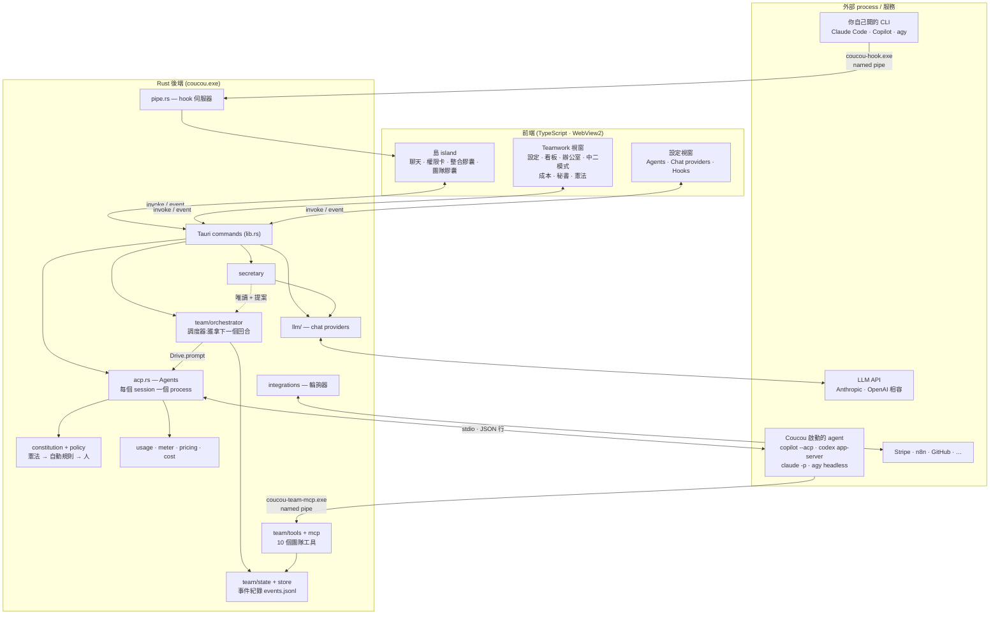

前後端之間只有兩種訊息:

- **前端 → 後端**:Tauri command(`team_start`、`team_instruct`、`team_permit`、`acp_send`、`secretary_ask`…)
- **後端 → 前端**:事件(`hook`、`integration`、`acp-update`、`acp-permission`、`team-changed`、`team-screen`、`secretary-step`)

金鑰與檔案內容永遠不跨過這條邊界:前端只能問「這把金鑰存在嗎」。

---

## 4. Agent 接入 Coucou 的三種方式

### 4.1 觀察 — Hook(你自己開的 session)

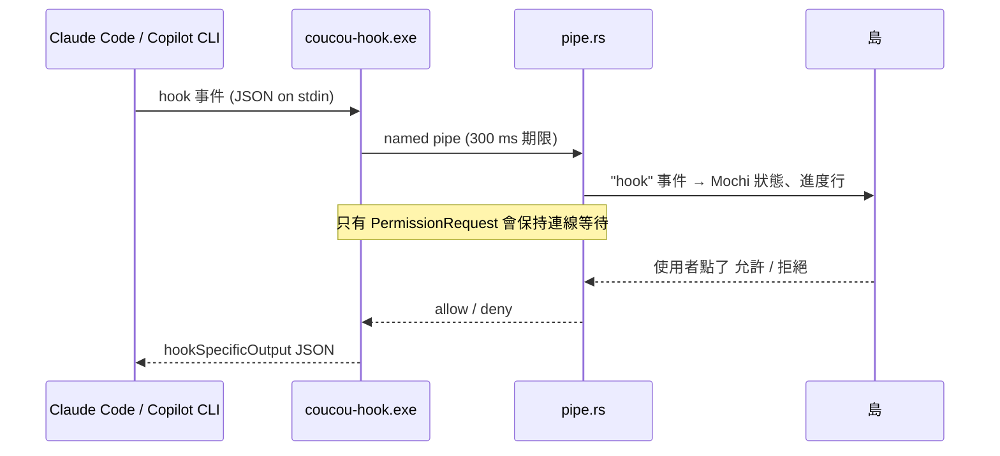

- Coucou 沒開、太慢或當掉 → hook 立刻結束,CLI 照常在終端機詢問。
- Hook 安裝遵守 `CLAUDE.md` 的規定:帶日期的備份 → 合併 → 顯示 diff → 使用者點擊後才寫入(`hooks.rs`)。
- 團隊成員的 CLI 啟動時帶有 `COUCOU_TEAM` / `COUCOU_MEMBER` 環境變數,hook 看到就保持沉默 — 成員的步驟與權限改走團隊通道,不會重複出現。

### 4.2 駕駛 — Coucou 啟動並控制的 agent

**Settings → Agents** 裡的每一筆是一個 `AgentProfile`(`acp.rs`):

```rust
pub struct AgentProfile {
    pub id: String,
    pub name: String,
    pub command: String,              // 在 PATH 上尋找的執行檔
    pub args: Vec<String>,
    pub env: BTreeMap<String, String>, // 值裡的 "{secret}" 會換成 Credential Manager 的金鑰
    pub cwd: String,
    pub protocol: Protocol,            // Acp | Codex | Claude | Agy
    pub model: String,
}
```

四種協定都被翻譯成同一組內部事件,所以上層(島的聊天、團隊調度器)不需要知道對面是誰:

| `Protocol` | 對象 | 啟動方式 | 線上格式 | 權限如何回到 Coucou |
|---|---|---|---|---|
| `Acp` | Copilot CLI、Gemini CLI、任何 ACP agent | `copilot --acp --stdio` | JSON-RPC 2.0(Agent Client Protocol) | `session/request_permission` |
| `Codex` | Codex CLI | `codex app-server` | JSON-RPC 2.0(Codex 自己的) | `item/*/requestApproval` |
| `Claude` | Claude Code | `claude -p --input-format stream-json …` | stream-json(Agent SDK 用的協定) | `control_request: can_use_tool` |
| `Agy` | Antigravity | `agy --input-format stream-json …` | NDJSON | 工作資料夾裡的 PreToolUse hook → `coucou-team-mcp --gate` |

共用的執行模型(`acp.rs`):

- **`Agents`**:以 *session key* 索引的所有 session。聊天用 profile id 當 key;團隊用 `team:<團隊>:<成員>`。因此**同一個 profile 可以同時扮演多個成員**,彼此不互等。
- **`Slot`**:每個 session 自己的回合鎖與 process。只有同一個 session 的回合會排隊。
- **`Launch`**:這個 session 相對於 profile 額外帶的東西 — 工作資料夾、環境變數、MCP server、自動核准範圍(`Scope`)、模型。
- **`Sink`**:session 事件的去處。聊天的 sink 直接送到島;成員的 sink 送到團隊調度器。

```rust
pub enum Event {
    Update(AcpUpdate),         // 文字片段、工具呼叫(一律整理成 ACP session/update 的形狀)
    Permission(AcpPermission), // 需要人回答的權限請求
    Exit(String),              // process 結束
    Usage(Usage),              // 自上次回報後新增的 token 用量
    Refused(Refusal),          // 被憲法直接拒絕的請求
}
```

### 4.3 聊天 Provider — 直接呼叫 LLM API

`llm/` 不是 agent,而是「一問一答的模型端點」:Anthropic Messages、OpenAI Chat Completions、OpenAI Responses 三種線路。對話歷史以中性格式保存,可在 provider 之間延續。島的聊天、檔案問答與**秘書**都走這一層。

---

## 5. 團隊協作:Agent 之間如何被管理

### 5.1 核心原則

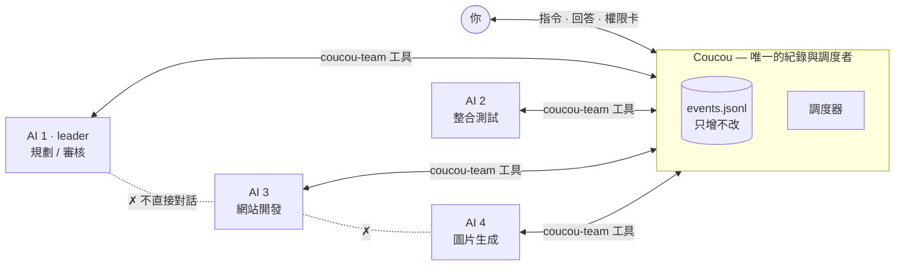

1. **CLI 彼此無法溝通,Coucou 也不嘗試讓它們直接溝通。** 成員看不到別人的畫面或回覆;唯一能傳到別人那裡的,是透過工具送出與交付的東西。
2. **每個變化都是一個事件。** 狀態 = 依序套用所有事件的結果(`team/state.rs`)。重啟後重播檔案就能還原所有畫面,畫面上每個數字都可追溯。
3. **成員只會在「回合開始」時聽到東西。** 所以整個協調問題被簡化成:*當某成員不在回合中、且有東西在等它(任務就緒、交付、訊息)時,給它一個以那些內容開頭的回合。*
4. **規則由 Coucou 判斷,不問模型。** 權限、誰能跟誰說話、任務能不能開始,全是可測試的純函式。

### 5.2 團隊設定

一個團隊是一份 JSON(`team/mod.rs` 的 `TeamConfig`,範例見 `team/example.json`):

```jsonc
{
  "id": "shop",
  "name": "購物網站團隊",
  "goal": "建立一個購物網站…",          // 使用者的原話
  "workDir": "D:\\Projects\\shop",       // 所有成員共用的工作資料夾
  "leader": "ai1",                        // 拆目標、派任務、審核的人
  "autoApprove": true,                    // 自主協作:安全步驟不出卡片
  "members": [
    { "id": "ai1", "name": "AI 1", "role": "規劃",     "agent": "copilot" },
    { "id": "ai3", "name": "AI 3", "role": "網站開發", "agent": "codex", "model": "…",
      "maxTokens": 2000000, "maxCostUsd": 5.0 }        // 每位成員可設上限
  ],
  "links": [
    { "from": "ai4", "to": "ai3", "kind": "delivery", "what": "圖片素材" }
  ],
  "expected": [{ "name": "測試報告", "detail": "…" }],
  "directTalk": true,      // 成員可互相傳訊;關閉後只能找 leader 或有 link 的對象
  "sharedBoard": true,     // 成員看得到整個看板;關閉後只看自己的任務
  "maxTurns": 60           // 全隊回合上限,用完就暫停等人
}
```

`member.agent` 指向 Settings → Agents 的 profile id — **成員是「角色」,agent profile 是「引擎」**,一個引擎可以坐很多個位子。

### 5.3 成員的工具(`coucou-team` MCP server)

每個成員的 CLI 啟動時都被塞入一個 MCP server:`coucou-team-mcp.exe`,並帶著 `COUCOU_TEAM`、`COUCOU_MEMBER`、`COUCOU_TEAM_TOKEN`(128 位元的隨機權杖,每個位子一把)。中繼連上 named pipe、報上身分、驗證權杖後,每一行 JSON-RPC 原樣轉送給 `team/mcp.rs`。

| 工具 | 誰能用 | 作用 | 產生的事件 |
|---|---|---|---|
| `team_status` | 所有人 | 我的任務、看板、已交付項目、新訊息 | `Heard` |
| `task_create` | **leader** | 建立任務:owner、驗收條件、`depends_on`、`deliver_to`、優先度 | `TaskCreated` |
| `task_assign` | **leader** | 把任務改派給別人 | `TaskAssigned` |
| `team_finish` | **leader** | 全部驗收且已回報後,結束團隊 | `FinishAsked` |
| `task_update` | owner / leader | 回報開始(`doing`)、勾選已達成的條件、備註 | `TaskUpdated` |
| `task_block` | owner | 卡住了:原因 + 在等誰(成員或 `you`) | `TaskBlocked` + `Message` / `Asked` |
| `deliver` | owner | 交付:成果位置(工作資料夾內的路徑,或 URL)+ 摘要 | `Delivered` + 給審核者的 `Message` |
| `review` | leader / 收件者 | 驗收或退回(退回必須附原因) | `Reviewed` |
| `message_send` | 所有人 | 傳訊給成員、`you` 或 `all`(受 `may_talk` 限制) | `Message` |
| `ask_human` | 所有人 | 只有使用者能決定的問題 | `Asked` |

`team/tools.rs` 的 `call()` 是純函式:**(狀態, 成員, 工具, 參數) → (給成員的一行回覆, 要記錄的事件)**。被拒絕的呼叫會回一句成員能據以行動的話(例如「只有 leader 能建立任務,請用 `message_send` 找 leader」),而不是協定錯誤。

唯一碰到磁碟的檢查:`deliver` 的路徑必須真的存在 — 不能空口說「做完了」。

### 5.4 任務生命週期

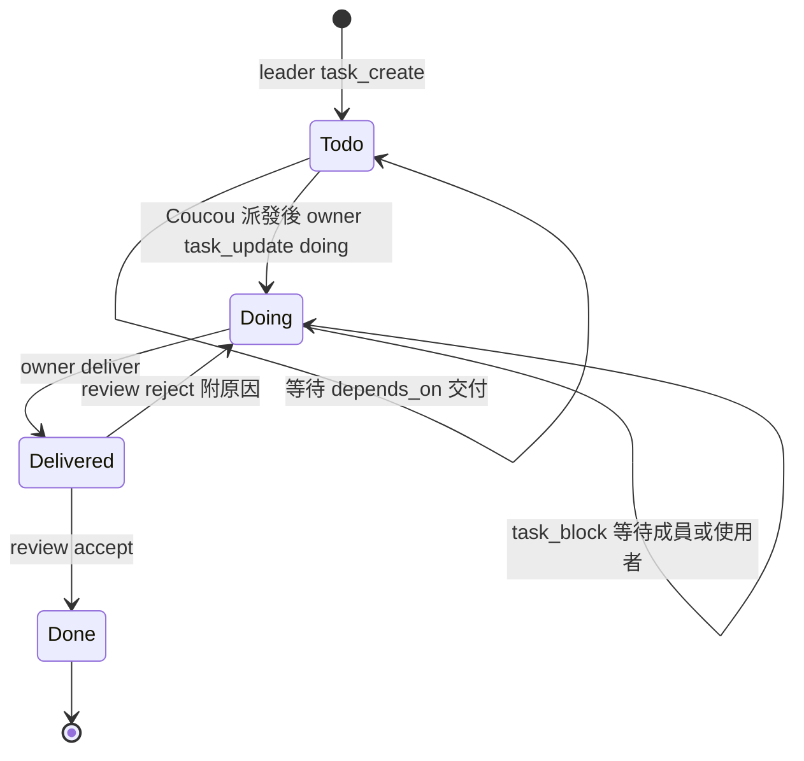

- **派發是 Coucou 自己做的**(`tools::react`):任務的所有相依都已交付時,自動記下 `Dispatched` 並送一則訊息給 owner — leader 不需要盯著。
- **誰來審核**(`State::reviewer`):預設是 leader;若任務是 leader 自己做的,則由 `deliver_to` 的收件者審;都沒有就直接視為通過。
- **同一任務被退回 3 次** → 團隊暫停,請人來看。
- **全部任務都 Done** → Coucou 請 leader 寫總結報告(`Wrapping`),leader 呼叫 `team_finish`;等到沒有人在工作、沒有未讀訊息時才真正 `Finished`。

### 5.5 調度器:誰拿到下一個回合

每個團隊一個迴圈(`orchestrator.rs` 的 `Team::run`),平時睡著,狀態一變就被叫醒:

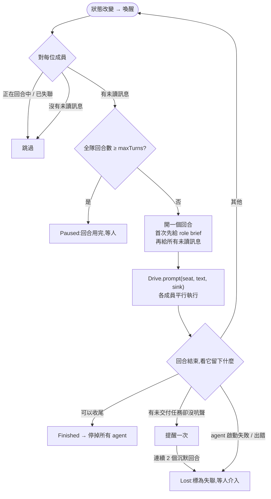

幾個值得注意的設計:

- **回合的內容永遠是「訊息」。** 任務派發、交付通知、退回原因、使用者指令、提醒,全部都是一則 `Message`(寄件者是成員、`you` 或 `system`)。調度器只需要一條規則:有未讀就給回合。
- **Role brief 只講一次**(`team/brief.rs`):成員的 session 第一次開口前,先被告知它是誰、目標、隊友、交付關係、工作資料夾、憲法、以及每個工具什麼時候用。Session 重啟(當機、Coucou 重開)就再講一次。
- **「不要等、不要輪詢」** 被明確寫進 brief:成員做完該做的就結束回合,有新東西時自然會拿到下一個回合。
- **預算是硬性的**:每位成員的 token / 金額上限一到,團隊立刻 `Paused` 並中斷該成員的回合,直到上限被調高。
- **人永遠可以介入**:`team_instruct`(對 leader 或任一成員下指令)、`team_answer`(回答問題)、`team_pause` / `team_resume` / `team_interrupt`、`team_recover`(救回失聯成員)、`team_join`(執行中加人)。完成的團隊收到新指令會 `Reopened`。

### 5.6 一次完整的協作

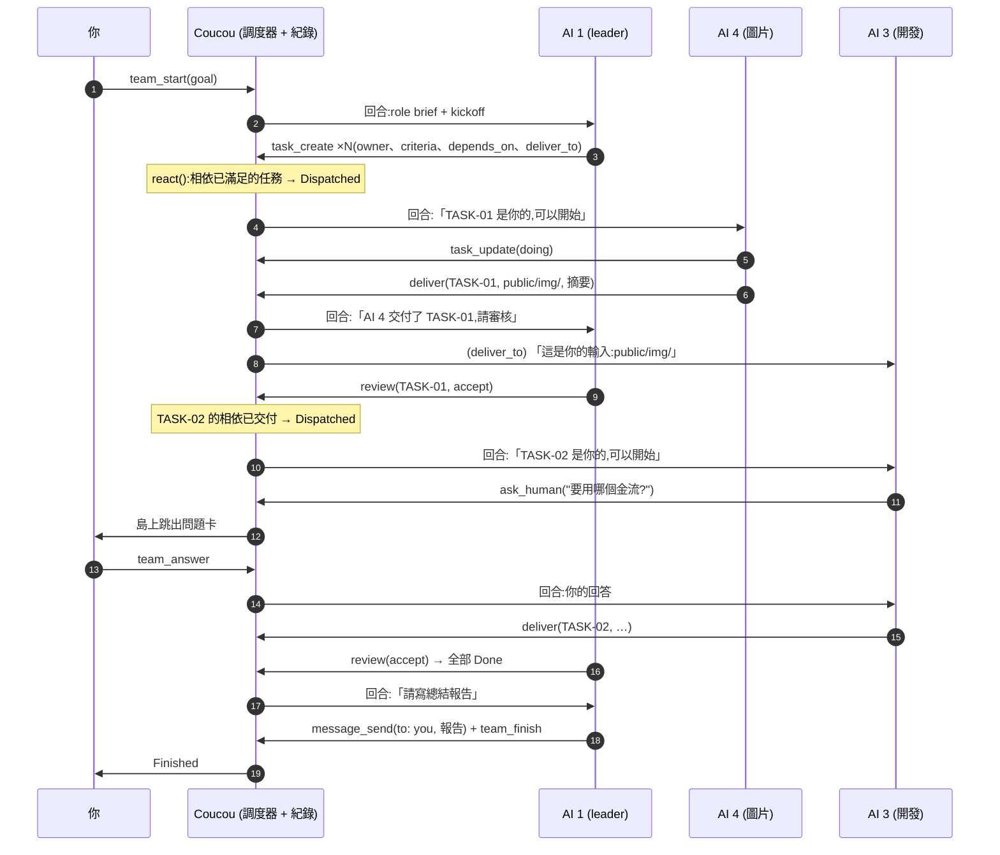

### 5.7 誰可以跟誰說話

`TeamConfig::may_talk(from, to)`:

- 任何人都可以找 **leader** 與 **你**;leader 可以找任何人。
- `directTalk: true` → 成員之間自由傳訊。
- `directTalk: false` → 只有被 `links` 連起來的兩端可以互傳(方向不拘)。
- 只有 leader 可以寫給 `all`(除非開了 directTalk)。

訊息不是即時的:對方在**下一個回合開始時**才讀到。這是刻意的 — 它讓每個 agent 的回合保持完整、可重播。

### 5.8 三層權限防線

成員每一個需要權限的步驟,依序通過:

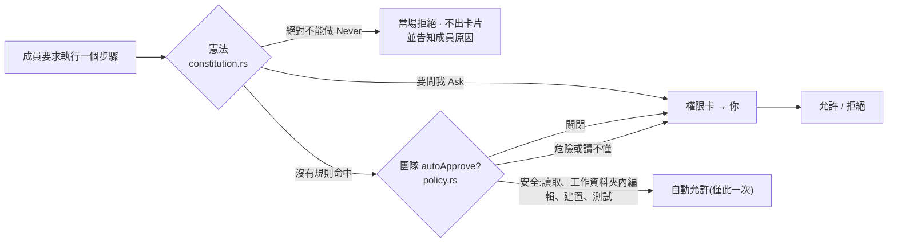

| 層 | 檔案 | 內容 |
|---|---|---|
| **憲法** | `constitution.rs` | 適用於 Coucou 驅動的**所有** agent(每個團隊的每位成員 + 聊天的 agent)。內建 7 條(刪除 `.git`、動到系統資料夾、安裝、破壞性 git、對外發送、變更系統、下載),可調為 關閉 / 要問我 / 絕對不能做,也可自訂關鍵字規則。也會寫進每位成員的 brief。 |
| **自動規則** | `policy.rs` | 只在團隊開了 `autoApprove` 時生效。以工具種類、指令列、路徑判斷;危險類別:`deletes-folder`、`deletes-many`、`installs`、`downloads`、`destructive-git`、`sends-out`、`outside-work-dir`、`system`、`opaque`(讀不懂就問)。 |
| **人** | 島 / Teamwork | 卡片會顯示為什麼需要你(哪一種危險、哪一條憲法)。 |

沒有任何一層會去問模型「這安全嗎」。團隊以外的 agent(聊天、hook 進來的 session)不適用自動規則 — 每個請求都是一張卡。

### 5.9 觀察與呈現

所有畫面都讀同一份 `Snapshot`(`team-changed` 事件),沒有自己的狀態:

| 畫面 | 位置 | 內容 |
|---|---|---|
| 看板 Monitor | `src/team/main.ts` | 成員狀態(工作中 / 等交付 / 等回覆 / 等你 / 閒置 / 完成 / 失聯)、任務、交付物、時間軸 |
| 即時畫面 | `team/screen.rs` → `team-screen` | 每位成員正在說的話、執行的工具與輸出(只在記憶體,最近幾百行) |
| 協作關係 / 溝通紀錄 | `src/team/screens.ts` | links 圖、訊息串 |
| 辦公室 Office | `src/team/office/` | 每隊一間房,成員坐在自己的桌前;公司總覽是所有團隊的地圖 |
| 中二模式 | `src/team/office/battle/` | 同一份資料的另一種投影:目標是魔王,每個任務 100 HP,交付是攻擊、驗收是擊破。**純呈現,不寫回任何東西** |
| 成本 | `cost.rs` · `src/team/cost.ts` | 依期間 / 團隊 / 成員 / agent / 模型的 token 與估算金額 |
| 島上的膠囊 | `src/island/team.ts` | 一隊一顆:進度;有人等你或失聯時加徽章、播音效、主動彈出 |

### 5.10 用量與成本

- 各驅動在得知用量時回報 `Event::Usage`(永遠是「自上次回報後的增量」,所以可以直接相加)。
- Copilot CLI 走 ACP 時不回報 token → 若成員使用自己的 OpenAI 相容端點,Coucou 的 **meter**(`meter.rs`)會在 `127.0.0.1:<port>/m/<token>` 開一個本機轉發點,原封不動轉送請求並讀出回應裡的 `usage`。
- `pricing.rs`:價格來源依序為 使用者自訂 → 端點的 LiteLLM `/model/info` → 內附的 LiteLLM 價目表。除非使用者點擊,否則不發任何網路請求。

### 5.11 秘書

`secretary.rs`:一個**被叫到才出現**的聊天模型,手上只有 Coucou 的「辦公室工具」— 沒有檔案、沒有 shell。

- **唯讀工具**:`list_teams`、`team_detail`、`team_messages`、`usage_summary`、`cost_analysis`、`list_agents`、`agent_models`
- **提案工具**:`propose_team`、`propose_instruction`、`propose_team_action`(啟動 / 暫停 / 繼續 / 立刻停下 / 封存)

提案**不會自己發生**:Teamwork 視窗顯示提案卡,只有使用者按下「確認」才會執行。這與 `CLAUDE.md` 的原則一致 — 沒有明確的點擊,就沒有動作。

### 5.12 持久化與復原

- 紀錄:`%LOCALAPPDATA%\Coucou\teams\<id>\events.jsonl`,一行一筆、只增不改。
- 團隊設定:JSON 檔(`settings::team_configs_dir()`)。
- **`revive`**:Coucou 重開後,從紀錄接續。Agent 是全新的 session(之前的記憶隨 process 消失),所以每位成員會重新聽到 role brief 與目前進度;失聯的成員一併回來。
- 過去的執行(`PastRun`)保留在旁,可在辦公室側欄回看。

---

## 6. 現有的擴充接縫

接入新東西之前,先認識程式碼裡已經留好的五個接縫:

| 接縫 | 位置 | 意義 | 改動成本 |
|---|---|---|---|
| **`AgentProfile` + `Protocol::Acp`** | `acp.rs` | 任何會在 stdio 上說 ACP 的執行檔,填一筆設定就是一個 agent | **零程式碼**(只要對方會說 ACP) |
| **`Launch.mcp_servers`** | `acp.rs` · `orchestrator.rs::seats_for` | 每個 session 可帶多個 stdio MCP server;目前只塞了 `coucou-team` | 小 |
| **`Protocol` enum + 翻譯模組** | `acp.rs` + `codex.rs` / `claude.rs` / `agy.rs` | 新協定 = 新 enum 值 + 一個翻譯檔;共用 process、鎖、sink、權限規則 | 中(約 8 處 `match profile.protocol`) |
| **`Drive` trait** | `orchestrator.rs` | 調度器只認得 `prompt / answer / cancel / stop`;測試用 `Scripted` 假成員就是靠它 | 中 |
| **`Opener` / `Transport`** | `acp.rs` | agent 的「兩端」只是一對 `AsyncRead` / `AsyncWrite`;不一定要是子 process | 中 |

---

## 7. 整合 n8n 等外部 Agent Endpoint

> 本節為設計提案,尚未實作。

### 7.1 先看清楚差異

目前的成員都是**本機的 coding CLI**;n8n 串好的 agent 是**遠端的 HTTP endpoint**。兩者在五個地方不同,而整合方案就是在回答這五題:

| | 本機 coding CLI | n8n Agent Endpoint | 必須解決的問題 |
|---|---|---|---|
| 傳輸 | stdio 上的 JSON 行,長駐 process | HTTP 請求 / 回應(Webhook 或 Chat Trigger) | 誰來把「回合」翻成「HTTP 請求」 |
| 團隊工具 | 自己當 MCP client 呼叫 `coucou-team` | 碰不到本機 named pipe | **誰替它呼叫 `task_update` / `deliver`** |
| 檔案 | 直接讀寫 `workDir` | 看不到你的磁碟 | 輸入怎麼給、成果怎麼落地 |
| 權限 | 每一步都經過 憲法 → policy → 人 | 步驟發生在 n8n 內部,Coucou 看不到 | 信任邊界畫在哪 |
| 時間 | 串流、可中斷 | 同步回應有逾時;長任務需非同步 | 長任務與取消 |

目前 Coucou 對 n8n 只有**觀察**:`integrations.rs::poll_n8n` 每 15 秒讀最新一筆 execution,顯示成整合膠囊(金鑰 `n8n-api-key`、`n8n-url` 存在 Credential Manager)。以下四個方案由淺到深。

### 7.2 四個方案總覽

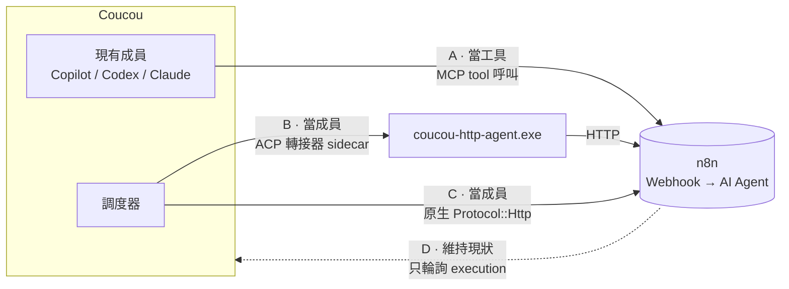

| 方案 | n8n agent 的身分 | 核心改動 | 適合 |
|---|---|---|---|
| **A. 當工具** | 現有成員手上的一把工具 | 新增一個 MCP server | 「查詢 / 轉換 / 觸發流程」型的 endpoint |
| **B. ACP 轉接器** ⭐ | 團隊成員(有位子、有任務) | 新增一個小執行檔;**核心零改動** | 第一步;一個到數個 endpoint |
| **C. 原生 HTTP 驅動** | 團隊成員,一等公民 | `Protocol::Http` + 設定 UI | endpoint 很多、要最好的體驗時 |
| **D. 只觀察** | 整合膠囊 | 無(已存在) | n8n 自己就是編排者 |

### 7.3 方案 A — 把 endpoint 當成「工具」

讓現有成員(有檔案存取權的 coding agent)在需要時呼叫 n8n,由它負責把結果寫進工作資料夾並 `deliver`。

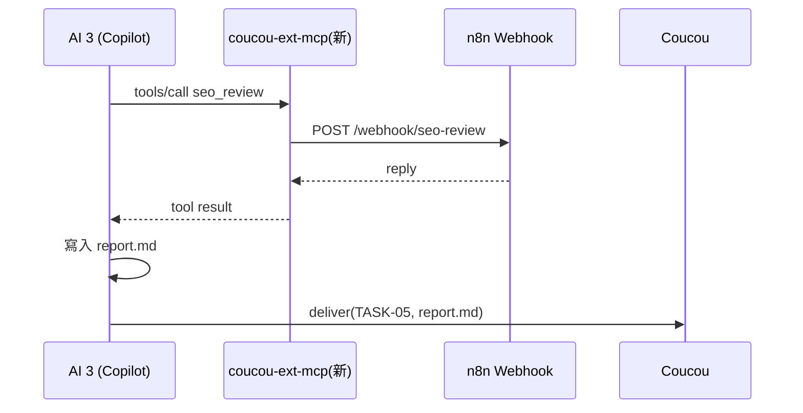

**做法**

1. 新增一份「外部工具」設定(名稱、說明、URL、驗證標頭、輸入 schema),金鑰放 Credential Manager。
2. 新增一個 stdio MCP server(可以仿照 `team-mcp` 的中繼模式:邏輯留在主程式,中繼只轉送),`tools/list` 把每個 endpoint 列成一個工具。
3. 在 `orchestrator.rs::seats_for` 把它加進 `Launch.mcp_servers`(現在只有 `coucou-team` 一個)。

**優點**:改動最小;交付、審核、權限流程完全不變;endpoint 不需要懂團隊規則。
**限制**:n8n agent 不是看得見的成員(不出現在辦公室、沒有自己的任務與成本列)。
**要注意**:Copilot 對 Coucou 自己的 MCP server 是以 `--allow-tool` 免卡片執行的。呼叫外部 endpoint 等於「把資料送出這台機器」,建議這個新 server **不要**沿用免卡片,或在主程式端把每次呼叫當作 `sends-out` 走一次憲法判斷。

> **變體**:n8n 較新的版本有 *MCP Server Trigger* 節點,可把 workflow 直接公開成 MCP server(HTTP 傳輸)。目前 `McpServer` 只描述 stdio 傳輸,所以要嘛用一個 stdio↔HTTP 的橋接程式當 `command`,要嘛擴充 `McpServer` 支援 HTTP。請先確認你的 n8n 版本是否有此節點。

### 7.4 方案 B — ACP 轉接器 sidecar(建議的第一步)

**想法**:Coucou 已經能駕駛「任何在 stdio 上說 ACP 的執行檔」。所以寫一個小執行檔 `coucou-http-agent.exe`,對 Coucou 說 ACP,對 n8n 說 HTTP。它和 `hook/`、`pty/`、`team-mcp/` 一樣是 Cargo workspace 裡的一個小 crate。

**Coucou 這邊只需要填一筆 Agent 設定,不改任何核心程式碼:**

```jsonc
{
  "id": "n8n-researcher",
  "name": "n8n 研究員",
  "command": "coucou-http-agent",
  "args": ["--url", "https://n8n.example.com/webhook/researcher"],
  "env": { "AGENT_AUTH": "Bearer {secret}" },   // {secret} 由 Credential Manager 的 agent:n8n-researcher 帶入
  "protocol": "acp"
}
```

**轉接器需要實作的 ACP 表面很小**(對照 `acp.rs` 的 `setup` / `prompt` / `dispatch`):

| Coucou → 轉接器 | 轉接器要做的事 |
|---|---|
| `initialize` | 回 `agentInfo`、`agentCapabilities` |
| `session/new { cwd, mcpServers }` | 記下 `cwd`;**記下 `mcpServers` 裡的 `coucou-team`**(指令 + 三個環境變數);回 `sessionId` |
| `session/prompt { prompt:[{type:"text",text}] }` | 呼叫 n8n;過程中送 `session/update`;最後回 `{ stopReason:"end_turn", usage? }` |
| `session/cancel`(通知) | 中止進行中的 HTTP 請求 |

| 轉接器 → Coucou | 用途 |
|---|---|
| `session/update` · `agent_message_chunk` | 回覆文字 → 出現在成員的即時畫面 |
| `session/update` · `tool_call` / `tool_call_update` | 顯示「正在呼叫 n8n…」等步驟 |
| 回應中的 `usage`(`inputTokens`、`outputTokens`、`totalTokens`…) | 進入成本頁(`usage::from_acp`) |

這樣做完,**島上的聊天立刻可用**:在聊天列選這個 agent,問題就會送到 n8n。

**成為團隊成員還差一步:誰替它呼叫團隊工具?** n8n 碰不到本機的 named pipe,所以由轉接器代勞。`session/new` 已經把 `coucou-team` 的啟動方式與權杖交給它了,轉接器自己當 MCP client 即可。有兩種深度:

#### B1 — 轉接器代打(確定性,建議先做)

轉接器不含任何模型,照固定流程替 n8n 走完團隊禮節:

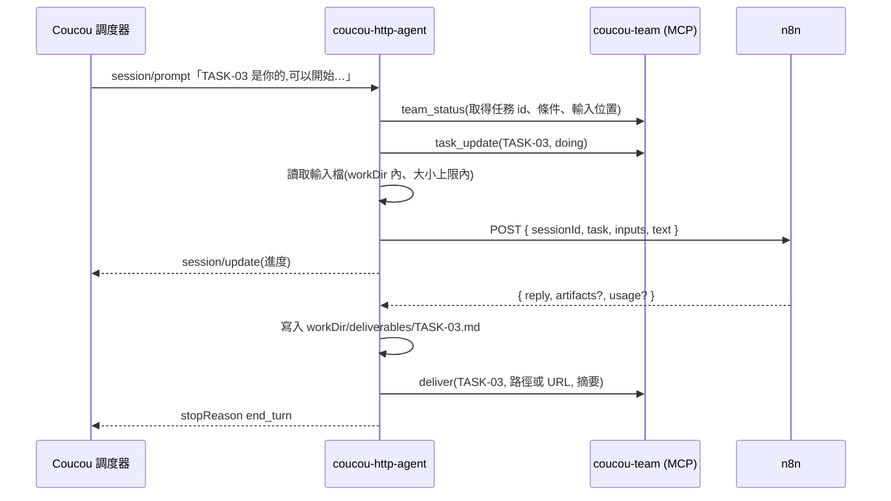

- 被退回(`review reject`)時,下一個回合的文字就是退回原因 — 原樣轉給 n8n 再做一次。
- n8n 回 `{ "needs": "human", "question": "…" }` → 轉接器呼叫 `ask_human`,結束回合;答案會是下一個回合的開頭。
- `deliver` 的 `locator` 可以是 **URL**(`tools.rs` 對 `http(s)://` 不做存在檢查),所以 n8n 把成果放在雲端硬碟、回一個連結也能交付。
- **限制**:這樣的成員適合當「執行者」,不適合當 leader — 它不會主動 `task_create` 或 `review`。

#### B2 — 工具回圈(n8n agent 成為完整成員)

把團隊工具的清單交給 n8n,讓它的 AI Agent 自己決定要呼叫什麼;轉接器執行後把結果送回去,直到它說做完:

```jsonc
// 轉接器 → n8n
{
  "sessionId": "team:shop:ai5",
  "text": "TASK-03 is yours and ready to start: …",
  "tools": [ /* tools/list 的原樣輸出:team_status、task_update、deliver、message_send… */ ],
  "toolResults": [ { "id": "c1", "text": "TASK-03 updated." } ]
}

// n8n → 轉接器
{
  "reply": "我先確認輸入…",
  "toolCalls": [ { "id": "c2", "name": "message_send", "arguments": { "to": "ai3", "text": "圖片尺寸要多少?" } } ],
  "done": false,
  "usage": { "inputTokens": 1830, "outputTokens": 212, "totalTokens": 2042 }
}
```

n8n 端可以用 Structured Output Parser 保證這個形狀。做到這一層,n8n agent 就能傳訊、卡住、發問,甚至擔任 leader。代價是 n8n workflow 必須照這份契約設計,且每個工具回圈多一次 HTTP 往返。

**方案 B 的優缺點**

- ✅ 核心零改動;沿用現有的 session 管理、即時畫面、成本、失聯偵測、`revive`
- ✅ 轉接器是通用的:任何「POST 文字、回 JSON」的 agent(Dify、Flowise、LangServe、自架 FastAPI)都能用同一支
- ✅ 可獨立測試(`acp.rs` 的測試已經示範了如何用腳本假扮 ACP agent)
- ⚠️ 設定要手填 command / args / env,沒有專屬 UI
- ⚠️ 多一個 process;每位成員一個

### 7.5 方案 C — 原生 `Protocol::Http` 驅動

當外部 endpoint 變多、想要一等公民的體驗時,把轉接器的邏輯搬進主程式:

```rust
pub enum Protocol { Acp, Codex, Claude, Agy, Http }   // 新增

pub struct HttpEndpoint {                // AgentProfile 的新欄位(Option)
    pub url: String,
    pub auth: Auth,                      // Bearer / 自訂標頭 / 無 — 可沿用 llm provider 的作法
    pub mode: Mode,                      // Sync | Stream | Async { poll_url }
    pub session_field: String,           // 例如 "sessionId"
    pub team_mode: TeamMode,             // Proxy(B1)| ToolLoop(B2)
    pub send_files: bool,                // 是否允許把 workDir 的檔案內容送出去
}
```

- 新檔 `http.rs`,與 `codex.rs` / `claude.rs` / `agy.rs` 並列,負責「一個回合 = 一次(或一串)HTTP 請求」的翻譯,輸出仍是同一組 `acp::Event`。
- 不需要子 process:可在 `spawn_agent` 以 `tokio::io::duplex` 提供 `Transport`,或在 `Agents::prompt` 的協定分支直接處理。
- **團隊工具可以在行程內直接呼叫 `Teams::act`**,不必繞 MCP 中繼與 named pipe。
- 設定視窗新增「HTTP / n8n endpoint」表單與 **Test connection**(仿 `provider_test` / `acp_test`)。
- 取消 = 中止請求;若有 n8n API 金鑰,可再呼叫 stop execution。

**代價**:要走過 `acp.rs` 裡大約 8 處 `match profile.protocol`,加上設定 UI 與型別(`src/core/state.ts` 的 `AgentProfile`)。reqwest 與 tokio 已經是相依,不需要新套件。

### 7.6 橫切議題(不論選哪個方案都要回答)

#### ① 長任務與逾時

n8n 的同步 webhook 受反向代理與平台逾時限制(n8n Cloud 尤其短);Coucou 一個回合的安全網是 30 分鐘(`TURN_TIMEOUT`)。

| 模式 | 作法 | 何時用 |
|---|---|---|
| 同步 | Respond to Webhook 直接回結果 | 一兩分鐘內做完 |
| 串流 | Webhook / Chat Trigger 的串流回應 → 逐段轉成 `agent_message_chunk` | 想看到即時輸出 |
| 非同步 + 輪詢 | Webhook 立刻回 `{ executionId }`;轉接器輪詢 `GET /api/v1/executions/{id}`(Coucou 已有這段程式與金鑰) | 長任務 |

**不建議**讓 n8n 回呼 Coucou:那需要 Coucou 開對外的監聽埠,違反目前「只對使用者設定的服務發出請求、本機只聽 127.0.0.1 與 named pipe」的姿態。

#### ② 對話記憶

每個位子有穩定的 key:`team:<團隊>:<成員>`。把它當 `sessionId` 傳給 n8n,接上 n8n 的 memory 節點即可。注意 `revive` 之後 Coucou 會重講一次 role brief — 遠端記憶還在時會重複,無害但可在轉接器端去重。

#### ③ 檔案進出

- **進**:任務訊息裡的輸入是路徑(`Input — TASK-01 … public/img/`)。遠端 agent 讀不到,由轉接器把文字檔內容內嵌(設大小上限),或改用 URL。
- **出**:寫回 `workDir`(轉接器落地),或回傳 URL 直接當 `locator`。
- 路徑檢查請比照 `team::preview_path`:canonicalize 後必須仍在 `workDir` 之內。

#### ④ 權限與信任邊界 — 最重要的一點

Coucou 的三層防線判斷的是**本機的步驟**。n8n workflow 內部做的事(寄信、發 Slack、寫資料庫)**Coucou 完全看不到,也擋不了**。

- 把 endpoint 視為一個**被使用者明確設定並信任的服務**(符合 `CLAUDE.md`:「只對使用者設定的服務發出網路請求」)。
- 設定頁應明講這條邊界,並提供「是否允許送出工作資料夾內容」的開關(預設關)。
- `CLAUDE.md` 規定「沒有明確點擊就不寄信」。若 n8n workflow 有對外副作用,請在 **n8n 端**加上人工核准節點,或設計成先回 `needs: human` 讓成員走 `ask_human`,使用者在島上回答後才繼續。
- 憲法的 `send-out` 規則可延伸一個檢查點:第一次對某個 endpoint 發送前出一張卡。

#### ⑤ 金鑰

沿用現成機制:`AgentProfile.env` 的 `{secret}` 於啟動時由 Credential Manager(`agent:<id>`)帶入。永不落地、永不進前端、不寫進 log(比照 `poll_n8n`:log 只記 HTTP 狀態碼,因為自架網址可能夾帶憑證)。

#### ⑥ 成本

讓 n8n 回傳 `usage` 與模型名稱,轉接器放進 `session/prompt` 的結果 → 自動進入團隊紀錄與成本頁,成員的 token / 金額上限也隨之生效。n8n 不回 `usage` 時,該成員的成本就是空白 — 上限不會觸發,請在文件與 UI 上說清楚。

#### ⑦ 失敗處理

現有機制已經涵蓋:HTTP 失敗 → 回合 `Err` → 成員 `Lost`(附原因)→ 島上徽章與音效 → 使用者 `team_recover`。轉接器只需要把錯誤訊息寫得讓人看得懂(狀態碼、不含憑證的主機名)。

### 7.7 建議的 n8n Webhook 契約

為了讓同一支轉接器適用於各種 endpoint,建議約定一個最小契約:

```jsonc
// POST  <webhook url>
// Authorization: Bearer …
{
  "sessionId": "team:shop:ai5",          // 穩定的對話 id
  "text": "…本回合的完整文字…",           // 必填;只支援這一欄也能運作
  "role": { "name": "AI 5", "role": "SEO 審稿", "team": "購物網站團隊" },
  "task": { "id": "TASK-03", "title": "…", "criteria": ["…"] },   // 有任務時
  "inputs": [ { "name": "copy.md", "text": "…" } ],               // 允許送檔時
  "tools": [ … ], "toolResults": [ … ]                            // 僅 B2
}
```

```jsonc
// 200 OK
{
  "reply": "…給人看的文字…",                                       // 必填
  "artifacts": [ { "name": "report.md", "text": "…" },             // 轉接器寫入 workDir
                 { "name": "預覽", "url": "https://…" } ],          // 或直接當 locator
  "summary": "一兩句交付摘要",
  "needs": null,                         // 或 { "kind": "human", "question": "…" }
  "toolCalls": [ … ], "done": true,      // 僅 B2
  "usage": { "model": "gpt-4.1", "inputTokens": 0, "outputTokens": 0, "totalTokens": 0 }
}
```

只實作 `text → reply` 也是合法的 — 其餘欄位都是選用的增強。

### 7.8 建議路線

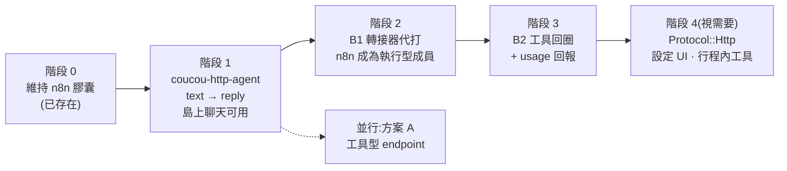

| 階段 | 交付 | 涉及檔案 | 驗收 |
|---|---|---|---|
| 1 | `windows/http-agent/`(新 crate):ACP ↔ HTTP,同步模式 | 新 crate、`windows/Cargo.toml`(workspace members)、`src-tauri/tauri.conf.json`(bundle resources,與其他三個小執行檔一樣複製到 `%LOCALAPPDATA%\Coucou\bin\`) | 在 Settings → Agents 新增後,**Test** 通過,島上聊天得到 n8n 的回覆 |
| 2 | 轉接器當 `coucou-team` 的 MCP client;B1 流程;檔案落地 | 同上 | 以 `team/example.json` 為底加一位 n8n 成員,能收到任務、交付、被審核、被退回後重做 |
| 3 | B2 契約;`usage`;非同步輪詢;取消 | 同上 | 成本頁出現該成員;上限能暫停團隊;30 秒以上的 workflow 不逾時 |
| 4 | 原生驅動與 UI | `acp.rs`、新 `http.rs`、`settings.rs`、`lib.rs`、`src/settings/main.ts`、`src/core/state.ts` | 不需要 sidecar;設定表單含 Test connection |

**為什麼從 B 開始而不是 C**:B 完全不動核心,可以先用真實的 n8n workflow 驗證契約(尤其是 B1/B2 哪種夠用、長任務怎麼處理);契約穩定之後,C 只是把同一套邏輯搬進行程內,風險小得多。

### 7.9 決策速查

- endpoint 只是「幫我查一下 / 轉一下 / 觸發一下」→ **方案 A**
- 想讓它在辦公室有位子、領任務、算成本 → **方案 B**(先 B1)
- 想讓它當 leader、或跟其他成員來回討論 → **B2**
- 外部 agent 超過三四個、要給非技術使用者設定 → **方案 C**
- n8n 自己就是編排者,Coucou 只需要知道成敗 → **方案 D**(現況)

---

## 8. 附錄:關鍵檔案索引

### 多 agent 管理(`windows/src-tauri/src/`)

| 檔案 | 一句話 |
|---|---|
| `team/mod.rs` | `TeamConfig` / `MemberConfig` / `Link`;`may_talk`;啟動前檢查 `problems` |
| `team/state.rs` | `Event` 列舉、`State`、事件如何累積成狀態、`Snapshot` |
| `team/store.rs` | `events.jsonl`:附加與重播 |
| `team/tools.rs` | 10 個團隊工具的規則(`call`)、Coucou 的自動反應(`react`)、MCP 描述(`describe`) |
| `team/brief.rs` | 給成員的所有文字:角色、任務、審核、提醒 |
| `team/mcp.rs` | named pipe 上的 MCP server;`coucou/gate`(agy 的權限閘) |
| `team/orchestrator.rs` | `Drive` trait、`Seat`、`Team::run` 調度迴圈、`Teams` 的對外操作 |
| `team/screen.rs` | 成員的即時畫面 |
| `acp.rs` | `AgentProfile`、`Protocol`、`Launch`、`Agents`;ACP client;權限請求的三層判斷 |
| `codex.rs` · `claude.rs` · `agy.rs` | 三種非 ACP 協定的翻譯 |
| `constitution.rs` · `policy.rs` | 憲法;自動核准規則 |
| `usage.rs` · `meter.rs` · `pricing.rs` · `cost.rs` | 用量、本機計量轉發、定價、成本報表 |
| `secretary.rs` · `llm/tools.rs` | 秘書與它的工具呼叫回圈 |
| `integrations.rs` | 七個整合的輪詢器(含 `poll_n8n`) |
| `pipe.rs` · `hooks.rs` | hook 的 named pipe 伺服器;hook 安裝 |

### 前端(`windows/src/`)

| 檔案 | 一句話 |
|---|---|
| `team/main.ts` | Teamwork 視窗的主畫面與導覽 |
| `team/types.ts` | 與 Rust `Snapshot` 對應的型別 |
| `team/live.ts` · `team/screens.ts` | 即時畫面;協作關係與溝通紀錄 |
| `team/office/` | `adapter-real.ts`(Snapshot → Office 契約)、`store.ts`、`scene.ts`、`floor.ts` |
| `team/office/battle/` | 中二模式:`projector.ts` 把真實任務投影成戰鬥 |
| `island/team.ts` | 島上的團隊膠囊與權限卡 |
| `core/bridge.ts` · `core/state.ts` | Tauri 橋接;島的狀態 |

### 相關文件

- `README.md`、`windows/README.md` — 使用說明與建置
- `docs/SPEC.md`、`docs/INTEGRATIONS.md` — 行為規格與整合(法文)
- `CLAUDE.md` — 專案鐵則(不卡住 CLI、金鑰只進 Keychain / Credential Manager、無遙測、明確點擊才行動)
