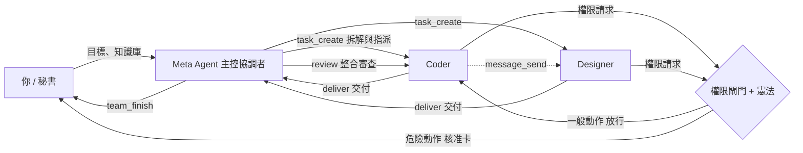
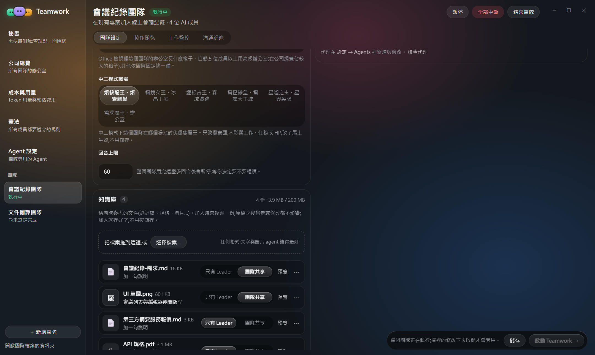
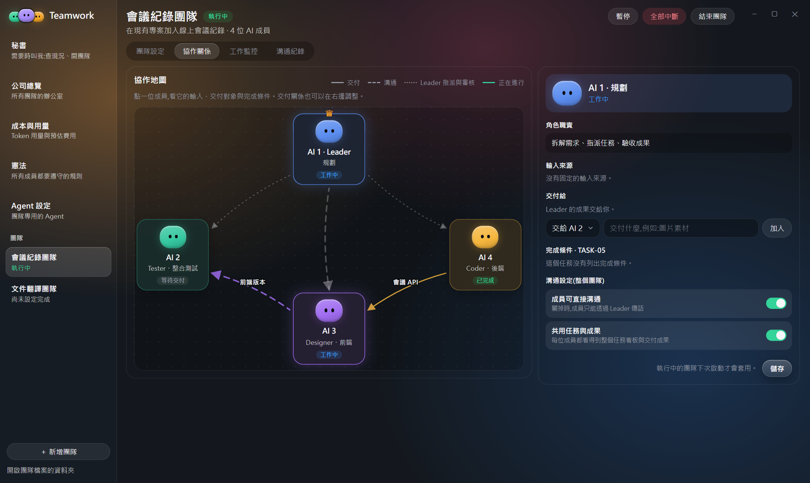
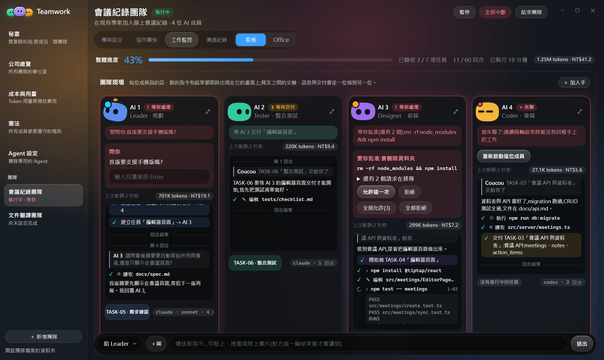
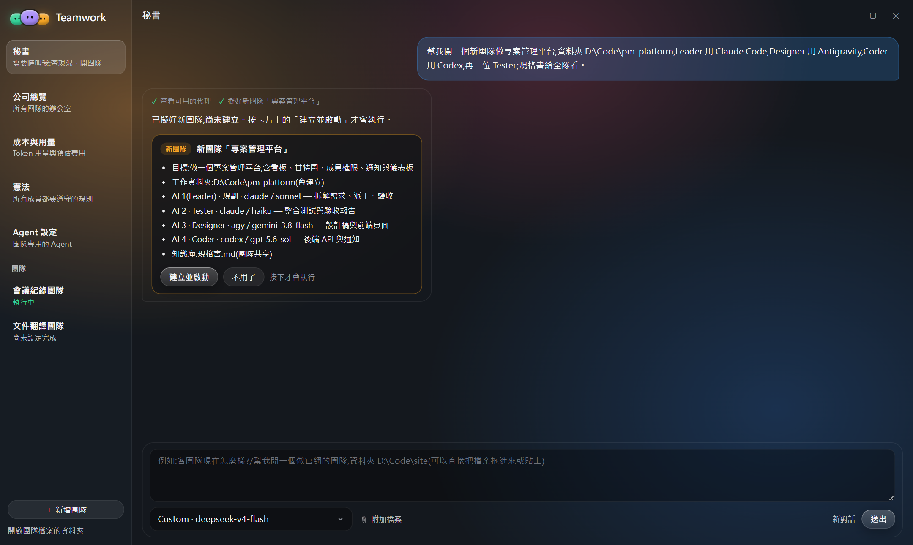
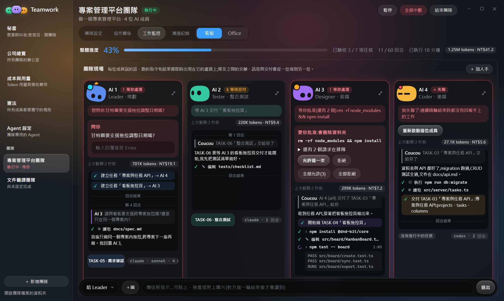
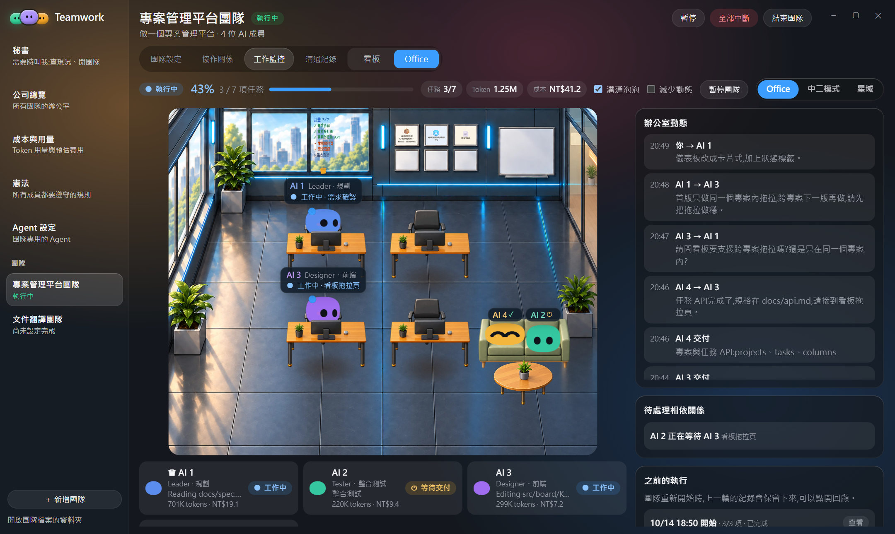

# Agent Center 說明報告:在桌面上編排你的 AI 夢幻團隊(AI Dream Team)

> 2026-10-15 · 截圖為示範資料(介面上的 Teamwork、Leader 即 Agent Center、Meta Agent)· 兩個案例為示意流程

---

## 1. 從「結對程式設計」到「多代理編排」

過去用 AI 寫程式,是一個人對一個 AI 的**結對程式設計(Peer Programming)**:你在終端機、編輯器之間切換,手動提問、複製貼上 Context、等它跑完再接下一步。你成了整條工作流的**人類瓶頸(Human Bottleneck)**,只能**單線程(Single-threaded)**地一件一件委派。

**Agent Center 是一個多代理編排(Agent Orchestration)平台**:你只要描述目標,由一位**主控協調者(Orchestrator,在 Agent Center 裡叫 Meta Agent)**拆解任務、指派給各有**角色 Persona** 的 Member Agent;Member Agent **並行(Parallelization)**寫程式、交付成果,Meta Agent 做**整合審查(Integration Check)**。Agent Center 就是整支團隊的**編排中樞(Orchestration Hub)**:傳話、記錄、權限把關,並把全隊即時畫在畫面上。你從「訊息中繼站」回到**架構師與指揮官**的位置,專心定義目標、驗收成果。

## 2. 解決什麼問題

| 人類瓶頸 | Agent Center 的做法 |
|---|---|
| 同時開好幾個終端機跑 Claude Code、Codex、Copilot,要自己記誰在做什麼 | 一個視窗看全隊的**即時畫面(Live Screen)**、任務看板與進度百分比 |
| AI 之間不能交接,只能手動複製貼上 Context | Member Agent 透過**團隊工具(Team MCP)**互傳訊息、登記**交付物(Deliverable)** |
| 前端要等後端寫完才能開始 | Meta Agent 依相依關係派工,沒有相依的任務**並行**推進,提升**吞吐量(Throughput)** |
| 放手讓 AI 跑 **Autopilot**,又怕它刪資料夾、亂裝套件 | **權限閘門(Permission Gate)**+**憲法(Constitution)**:一般動作放行,危險動作跳核准卡,禁止事項直接擋下 |
| 規格、設計稿要一份一份貼給 AI | **團隊知識庫(Knowledge Base)**:放一次,依可見性分給Meta Agent 或全隊 |
| 不知道花了多少 token | **成本與用量**頁、每位 Member Agent 的 token 與費用,掌握 **Token 預算** |
| 想知道「誰卡住、誰在等我」 | **秘書(Secretary)**用 Agent Center 的紀錄回答,也能擬好新團隊,按確認才執行 |

## 3. 核心概念

### 3.1 編排中樞(Orchestration Hub)
- 這些 CLI 彼此沒有原生互通方式,所以採**星狀架構(Hub-and-Spoke)**:每位 Member Agent 只跟 Agent Center 往來,由 Agent Center 派送、記錄與顯示。
- 「誰在做什麼、誰在等誰、交付了什麼」都來自 Agent Center 的**任務庫(Task Store,只增不改的事件紀錄)**,不靠 AI 的聊天內容去猜。進度 = 已驗收任務數 ÷ 總任務數。
- 團隊設定包含:名稱、任務描述、任務範圍、**工作資料夾(Work Folder)**、協作模式、回合上限(Turn Limit)、Member Agent 清單。

### 3.2 主控協調者 Meta Agent 與 Member Agent 角色 Persona
- 每個團隊由你指定一位 **Meta Agent(Orchestrator)**:拆解需求、指派任務、驗收成果、回答你,最後宣告團隊完成。
- 其他 Member Agent 各有角色 Persona:**職稱**全隊看得到,Meta Agent 依它派工;**職責**只給Member Agent 自己看。常見的編成是**規劃者(Planner)**、**程式開發者(Coder)**、**設計師(Designer)**、**測試者(Tester)**。
- **認知模型適配**:每位 Member Agent 選自己的基底 Agent 與模型,讓擅長推理的當 Meta Agent、擅長簡潔精準寫碼的當 Coder、擅長視覺的當 Designer:

| 基底 Agent | 連線方式 | 適合的角色(建議) | 備註 |
|---|---|---|---|
| Claude Code | stream-json(`claude -p`) | Meta Agent、Planner、Tester | 權限請求經 Agent Center 規則判斷 |
| Codex | `codex app-server` | Coder | 只自動放行 Agent Center 自己的團隊工具 |
| Copilot CLI(含自訂 BYOK 版本) | ACP | Coder、前端 | 用 `--additional-mcp-config` 掛上團隊工具 |
| Antigravity(agy,Gemini) | stream-json + PreToolUse 閘門 | Designer | MCP 只能放在工作資料夾 |

- **團隊 Agent(Team Agent)**:在「Agent 設定」把常用的 Persona 存起來,等於 Agent Center 版的 Custom Agents:名稱、基底、模型、system prompt、MCP server、skill,再寫一段說明讓秘書照著挑人。

### 3.3 團隊工具(Team MCP Tools):Member Agent 之間的協作協定
| 工具 | 誰用 | 作用 |
|---|---|---|
| `task_create` / `task_assign` | Meta Agent | 建立任務(完成條件、相依、交付對象)、指派 |
| `task_update` | Member Agent | 開工、勾選已達成的完成條件 |
| `task_block` | Member Agent | 卡住了:說明在等誰(隊友或你) |
| `deliver` | Member Agent | 登記交付物(路徑或網址 + 摘要 + 類型) |
| `review` | Meta Agent | 整合審查:驗收通過,或退回並說明原因 |
| `message_send` | 全部 | 傳訊給隊友、Meta Agent、全隊或你 |
| `ask_human` | 全部 | 直接問你問題 |
| `knowledge_read` / `knowledge_share` | Member Agent / Meta Agent | 讀知識庫;Meta Agent 在你點名後分享給全隊 |
| `team_finish` | Meta Agent | 宣告團隊完成 |

### 3.4 成果導向授權(Outcome-based),而非微觀管理
- Meta Agent 建任務時寫的是**要達成什麼**(完成條件),不是逐行指令;Member Agent 自己決定怎麼做。
- 例:「TASK-03 會議列表與編輯器頁面。完成條件:依 UI 草圖、手機版可用、列表可搜尋。」而不是「在 `page.tsx` 第 45 行插入一個 div」。
- 驗收也看完成條件:Meta Agent 逐條核對,沒達到就 `review` 退回並寫明原因。

### 3.5 協作模式與權限閘門(Permission Gate)
- **自主協作(Autopilot)**:改檔、建置、跑測試不問你;刪資料夾、安裝東西、對外發送等危險動作仍跳核准卡。
- **逐步確認(Step-by-step)**:每一個權限請求都問你。
- 核准卡同時出現在 Agent Center 視窗與瀏海島(Island)上,可以「允許這一次」或「全部允許」。
- **回合上限**:整隊用完這麼多回合就暫停,等你決定要不要繼續,守住 Token 預算。

### 3.6 憲法(Constitution):全隊共用的權限邊界
- 兩個等級:**要問我**(一定跳卡,卡上寫明條文)、**絕對不能做**(直接拒絕、不跳卡,以免誤點,並告訴 Member Agent 換做法)。
- 內建 7 條:刪除 .git、格式化磁碟或系統資料夾(絕對不能做);安裝軟體、會丟掉變更的 git 指令、對外發送、變更系統、下載(要問我)。
- 可以加自己的條文(例如「不能動 D:\重要資料」),由 Agent Center 依條文比對請求本身,不靠模型判斷。

### 3.7 團隊知識庫(Knowledge Base)與可見性(Visibility)
- 把設計稿、規格、報價等任何格式的文件加進團隊,Agent Center **複製一份**保存;Member Agent 不用你手動貼 Context。
- 每份文件可設 **只有 Meta Agent** 或 **團隊共享**;新加入的一律先只給Meta Agent。
- 小的文字文件在 Member Agent 開工時直接附全文,其他用 `knowledge_read` 讀取;一般 Member Agent 讀不到 Meta Agent 專用文件,也不會打擾你。
- 金鑰防呆:文字裡看起來像金鑰的內容會先被擋下,確認後才加入。

### 3.8 秘書(Secretary)
- 被叫才動,平常不花 token。用 Agent Center 的紀錄回答:各團隊進度、誰卡住、誰在等你、花了多少錢。
- 能擬好「開新團隊」「給團隊下指令」「暫停/繼續/封存」,以卡片呈現,**按確認才執行**(人在迴路中,Human-in-the-loop)。
- 可直接拖入或貼上檔案,開團隊時一起放進知識庫。

### 3.9 可觀測性(Observability)
- **工作監控**:看板模式顯示每位 Member Agent 的即時畫面、狀態(工作中、等待交付、等你處理、失聯)、token 與成本;Office 模式把團隊畫成辦公室;還有「中二模式」與「星域」兩種趣味視圖。
- **協作關係**:協作地圖顯示交付、溝通、Meta Agent 指派與驗收的連線,可設定 Member Agent 能否直接溝通。
- **溝通紀錄**:依任務分串的對話,可直接給Meta Agent 或特定 Member Agent 下指令、附圖。
- **成本與用量**:各團隊、各 Member Agent 的 token 用量與預估費用。

## 4. 一次編排的流程

1. 你在「團隊設定」(或請秘書)組建夢幻團隊:目標、工作資料夾、Member Agent Persona 與模型、Meta Agent、協作模式、知識庫。
2. 按「啟動 Teamwork」,每位 Member Agent 收到**開場說明(Briefing)**:角色、團隊工具、憲法條文、看得到的知識庫文件。
3. Meta Agent 讀需求,用 `task_create` 拆成帶完成條件與相依關係的任務並指派。
4. 沒有相依的任務並行推進;Member Agent 需要權限時經閘門判斷,危險動作跳卡給你。
5. Member Agent 用 `deliver` 交付,Meta Agent 用 `review` 整合審查,驗收或退回。
6. 結果不如預期時,你在溝通紀錄對 Meta Agent 下**二次指令**,由 Meta Agent 重新調度,不用自己動手改程式。
7. 全部驗收後 Meta Agent 呼叫 `team_finish`,交付物都在工作資料夾裡。

## 5. 案例一:用夢幻團隊寫一個「線上會議紀錄」功能(示意)

**目標**:在現有的 Next.js 專案加入會議紀錄:建立會議、即時共同編輯筆記、會後摘要與待辦、匯出 Markdown。

**團隊編成(認知模型適配)**

| 成員 | 角色 Persona | 基底 Agent | 為什麼這樣配 |
|---|---|---|---|
| AI 1 | Meta Agent・規劃 | Claude Code | 讀整個專案、拆需求、驗收 |
| AI 2 | Tester・整合測試 | Claude Code | 寫測試、跑測試、彙整驗收報告 |
| AI 3 | Designer・前端 | Antigravity | 依 UI 草圖做會議列表與編輯器 |
| AI 4 | Coder・後端 | Codex | 簡潔精準:資料表、API、即時同步 |

**知識庫**:`會議紀錄-需求.md`、`UI 草圖.png`(團隊共享);`第三方摘要服務報價.md`、`API 規格.pdf`(只有 Meta Agent)。

**Meta Agent 怎麼拆任務(成果導向)**

| 任務 | 負責 | 相依 | 完成條件 |
|---|---|---|---|
| TASK-01 需求拆解 | AI 1 Meta Agent | — | 任務與分工確定 |
| TASK-02 會議列表頁 | AI 3 Designer | — | 依 UI 草圖、手機版可用 |
| TASK-03 會議 API 與資料表 | AI 4 Coder | — | migration 可跑、CRUD 有測試 |
| TASK-04 編輯器頁面 | AI 3 Designer | 03 | 建立會議、即時共同編輯、匯出 Markdown |
| TASK-05 需求確認:摘要與通知 | AI 1 Meta Agent | — | 摘要要不要寄信有定論 |
| TASK-06 整合測試 | AI 2 Tester | 04 | 端對端測試全過 |
| TASK-07 驗收報告 | AI 2 Tester | 06 | 測試結果彙整成報告 |

TASK-02 與 TASK-03 沒有相依,Designer 與 Coder 從第一回合就並行開工。Meta Agent 只寫「要達成什麼」,不規定在哪個檔案第幾行做什麼。

**過程中的權限、提問與排錯**
- 放行:AI 4 跑 `npm run db:migrate`、AI 3 跑 `npm install @tiptap/react` 與測試,自主協作下直接放行。(如果把憲法「安裝軟體」設成要問我,安裝這一步會先跳卡。)
- 核准卡:AI 3 想 `rm -rf node_modules && npm install`,會刪資料夾,跳出核准卡等你按「允許這一次」或「拒絕」;後面還有 2 個請求在排隊,可以「全部允許」。
- 問你:Meta Agent 遇到只有你能決定的事,「首版要支援手機版嗎?」,直接在它的卡片上回覆。
- 隊友之間:AI 3 問 Meta Agent「會後摘要要寄給所有與會者,還是只顯示在會議頁面?」,Meta Agent 回覆「首版先顯示在頁面,寄信下一版再做」,不用你介入。
- 失聯:AI 4 交付 API 後連續兩輪沒回報,被標成失聯;按「重新啟動這位成員」就能接回來。

**最後產出**:會議 API 與資料表、列表頁與編輯器、測試與驗收報告都在工作資料夾;下一輪 Meta Agent 再把「會後摘要與待辦」派給 Coder。溝通紀錄保留每個任務的討論,成本頁看得到花了多少 token。

## 6. 案例二:用夢幻團隊做一個「專案管理平台」(示意)

**目標**:從零做一個小型專案管理平台:看板(Kanban)、甘特圖、成員與權限、通知、儀表板。

**怎麼開始**:把 `規格書.md` 拖進秘書的輸入框,一句話交代編成。秘書擬好新團隊卡片(成員、模型、知識庫可見性),你按「建立並啟動」才會真的建立。

**團隊編成**

| 成員 | 角色 Persona | 基底 Agent |
|---|---|---|
| AI 1 | Meta Agent・規劃(也寫執行藍圖) | Claude Code |
| AI 2 | Tester・整合測試 | Claude Code |
| AI 3 | Designer・前端 | Antigravity |
| AI 4 | Coder・後端 | Codex |

**Meta Agent 第一輪拆解**

| 任務 | 負責 | 相依 | 完成條件 |
|---|---|---|---|
| TASK-01 需求拆解與執行藍圖(`docs/blueprint.md`) | AI 1 Meta Agent | — | 資料模型與 API 規格寫定 |
| TASK-02 看板設計稿 | AI 3 Designer | — | 看板三欄、右側任務詳情 |
| TASK-03 專案與任務 API | AI 4 Coder | 01 | projects、tasks、columns 的 CRUD 與測試 |
| TASK-04 看板拖拉頁 | AI 3 Designer | 02、03 | 新增任務卡、拖拉換欄位、任務詳情面板 |
| TASK-05 需求確認:權限角色與通知 | AI 1 Meta Agent | — | 角色與通知規則有定論 |
| TASK-06 整合測試 | AI 2 Tester | 04 | 端對端測試全過 |
| TASK-07 驗收報告 | AI 2 Tester | 06 | 測試結果彙整成報告 |

甘特圖、儀表板與通知在第二輪才派,讓第一輪先把核心的看板做穩。

**中途調整與二次調度**
- 二次指令:第一版儀表板只是一張樸素的表格。你沒有自己改,而是對 Meta Agent 說「儀表板改成卡片式,加上狀態標籤」,Meta Agent 把它退回給 Designer 重做。
- 隊友之間:AI 3 問「看板要支援跨專案拖拉嗎?」,Meta Agent 回覆「首版只做同一個專案內拖拉」。
- 加人:進度過半時人手不夠,在工作監控按「＋ 加人手」再加一位 Coder,Meta Agent 立刻把通知模組派給它。
- 要問我:AI 4 要 `git push`,憲法「對外發送要問我」跳卡,你決定先不推。
- 回合上限:用完 60 回合自動暫停,守住 Token 預算;你到團隊設定調高再按繼續,紀錄全部接得上。

**最後產出**:可執行的平台原始碼、`docs/` 裡的執行藍圖與 API 規格、設計稿、測試與驗收報告;協作地圖記下誰交付給誰,方便回顧與重開。

## 7. 其他實際畫面

以下都是會議紀錄團隊的示範資料,版面與實機相同。

| 畫面 | 檔案 |
|---|---|
| 工作監控・Office 視圖 | `img/office.png` |
| 溝通紀錄 | `img/log.png` |
| 團隊設定 | `img/setup.png` |
| 憲法 | `img/law.png` |
| Agent 設定(團隊 Agent) | `img/agents.png` |
| 秘書・查各團隊現況 | `img/secretary-status.png` |
| 成本與用量 | `img/cost.png` |
| 公司總覽 | `img/company.png` |

## 8. 戰略價值與優點

1. **你不再是人類瓶頸**:描述目標、授權代理、驗收成果,中間的傳話與調度交給 Agent Center 和 Meta Agent。
2. **並行提升吞吐量**:沒有相依的任務同時推進,前端不用等後端。
3. **認知模型適配、不綁單一 AI**:Claude Code、Codex、Copilot、Antigravity 混編,各用所長、各用自己的模型與額度。
4. **消除重複性勞動(Toil)**:拆需求、寫測試、更新文件、跑建置交給Member Agent。
5. **放手但不失控**:Autopilot 省掉大量確認,危險動作由你決定,憲法的禁止事項不會被誤點放行。
6. **狀態有憑有據**:進度、等待、交付都來自任務庫事件,不從聊天內容猜。
7. **守住 Token 預算**:每位 Member Agent 只拿到自己需要的 Context,回合上限、成本頁隨時掌握花費。
8. **秘書代勞、可接續**:一句話查現況、開團隊;暫停、加人、調回合、重新開啟後都接得上。

---

Agent Center 說明報告 · 2026-10-15
